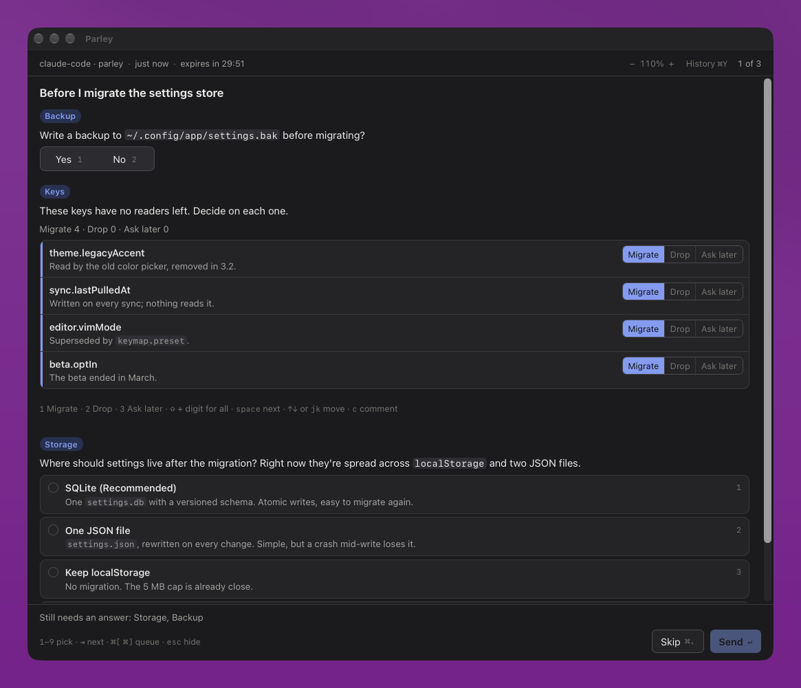
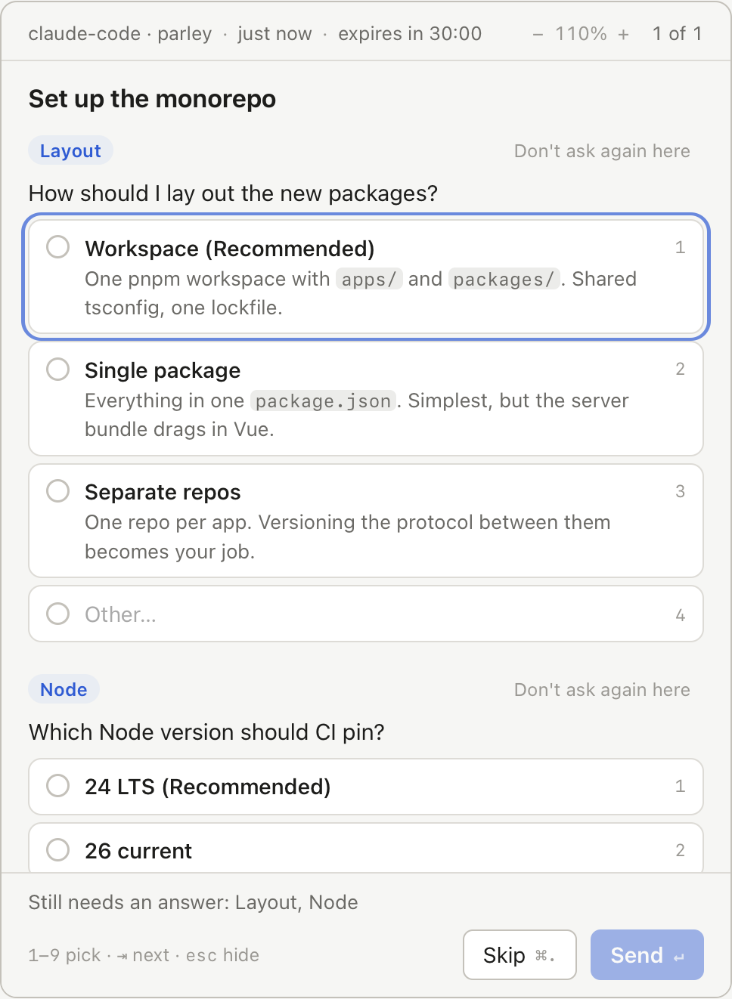
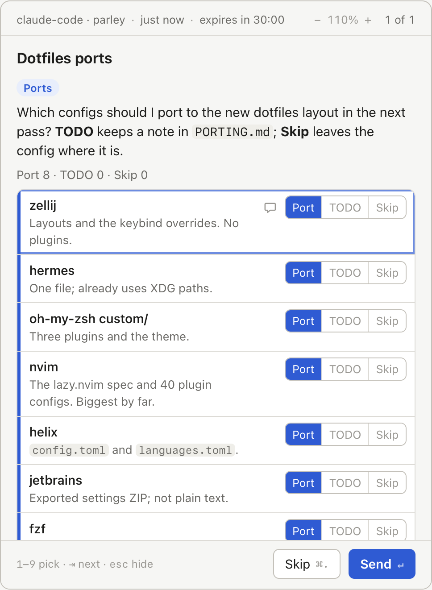
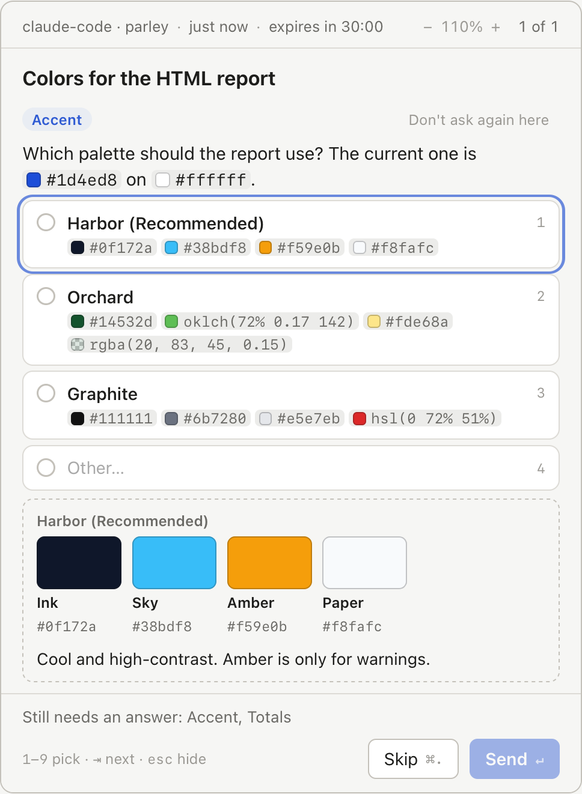
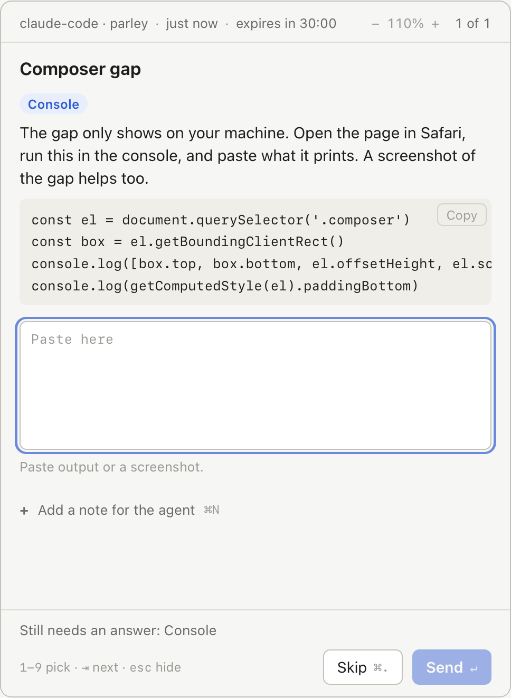

# Parley

An MCP server for the other end of the conversation: the model asking **you**. When an agent needs
a decision, it calls `ask` with a few questions, and you answer in a small floating window, or in
a card inline in Claude Desktop's chat, in a few keystrokes. Your answers go back to the model as
structured data with a plain-language summary.

It's built for daily use with coding agents: Claude Code, Claude Desktop, Codex, any MCP client.
macOS only, for now.



<table>
  <tr>
    <td width="50%"><picture>
      <source media="(prefers-color-scheme: dark)" srcset="docs/guide/images/cards/choice-dark.png">
      
    </picture></td>
    <td width="50%"><picture>
      <source media="(prefers-color-scheme: dark)" srcset="docs/guide/images/cards/review-decisions-dark.png">
      
    </picture></td>
  </tr>
  <tr>
    <td><picture>
      <source media="(prefers-color-scheme: dark)" srcset="docs/guide/images/cards/colors-dark.png">
      
    </picture></td>
    <td><picture>
      <source media="(prefers-color-scheme: dark)" srcset="docs/guide/images/cards/capture-dark.png">
      
    </picture></td>
  </tr>
</table>

Every question type, in light and dark: [What it looks like](docs/guide/screenshots.md).

## What it's built around

- **The model decides to ask.** Parley is a tool the model calls, not a server prompting the user.
  The server instructions tell it when asking is worth it, and a trial harness measures whether
  it does.
- **A form language models already write.** Questions are an array shaped like Claude's built-in
  `AskUserQuestion`, with more types: text, number, yes/no, file and folder paths, a review that
  gives each item of a list a decision (approve or reject, or the agent's own labels), a
  capture box for pasted output and screenshots, and a show block to put a plan or a project file
  in front of you, which you can edit in place. Project images and sounds can sit in any markdown. The
  server compiles them to JSON Schema, which is all the app renders.
- **An inbox, not a modal.** One app, many agents. Asks from every session queue up, labelled with
  who's asking; nothing steals your focus, and every ask is kept in history with what you sent.
- **Parley never answers for you.** A question you're tired of is retired in the project's own
  instructions, in a line you approve, not by Parley matching new asks against old answers.
- **Answers the model reads cleanly.** Structured JSON plus a summary, with your own wording marked
  as such, a note for the agent if you add one, and a sentence on what to do if you skip.
- **One card, two places.** The same card runs in the window and, in Claude Desktop, inline in the
  chat, where the first answer wins.
- **Your theme, from inn.** Colors come from inn's base16/base24 theme files, read where they are,
  so one file themes inn, Quire and Parley.
- **Local by design.** The server talks to the app over a unix socket only you can open. No port,
  no token, nothing on the network.

## Next to what exists

Asking the user isn't new. What's new is everything past a single blocking prompt.

- **MCP elicitation** (in the spec) lets a *server* ask the user for input mid-call. Its forms are
  flat (primitives and enums), and the client draws them, so the look and support vary; Claude
  Code draws a terminal dialog, and Claude Desktop supports only URL mode. Parley is the *model*
  choosing to ask, with richer inputs. Its choice questions use elicitation's enum shape, so a flat
  form could still be handed to native elicitation later.
- **MCP Apps** (`io.modelcontextprotocol/ui`) lets a tool render HTML inline in the host's chat.
  Parley uses it for the inline card in Claude Desktop. It doesn't exist in terminal clients, which
  is where the window comes in.
- **Pop-up ask-user servers** ([interactive-mcp](https://github.com/ttommyth/interactive-mcp),
  [mcp-interactive](https://mcpservers.org/en/servers/ivan-mezentsev/mcp-interactive), Human-in-the-Loop,
  user-feedback-mcp) show a question with options and free text in a dialog, one at a time,
  blocking. Parley adds the queue across sessions, history, review and path questions, notes, and
  answer shaping.

References: the [elicitation spec](https://modelcontextprotocol.io/specification/draft/client/elicitation),
[MCP Apps](https://github.com/modelcontextprotocol/ext-apps).

## What it does

How each part works, as you use it, is in [the guide](docs/guide/README.md).

- [A menu bar app](docs/guide/the-app.md), with no Dock icon or Cmd+Tab entry: a notification per
  ask with a sound you can pick, a count in the menu bar, and a title-bar-less window on Cmd+Ctrl+P that takes your typing without pulling
  you out of the app you're in, and hides when you click away (`hideOnBlur`, on by default).
- [Cards built for the keyboard](docs/guide/answering.md): number keys to pick, Cmd+Enter to send,
  a note for the agent, text boxes that grow to four lines (Enter is a new line), drafts that
  survive a restart.
- [Don't ask again here](docs/guide/answering.md#dont-ask-again-here) on a single-choice or yes/no
  question: the agent drafts a line for your project's `AGENTS.md` and saves it only if you accept
  it.
- [Seven question types](docs/guide/question-types.md): choice (with your own answer), text (or a
  draft to edit in place), number, yes/no, path, review (approve and reject, or the agent's own
  decisions, like Port / TODO / Skip), and capture (pasted output or a screenshot, which the agent
  gets as a file to read). And [shows](docs/guide/question-types.md#show): a plan, a design or a
  file from the project, which the server reads, in its own scrolling pane above the questions
  about it. A shown file can be [editable](docs/guide/question-types.md#editing-a-shown-file):
  Parley saves your edit to the file and hands the agent a diff.
- [Copy buttons](docs/guide/answering.md#code-in-a-question) on code in a question, for the
  command the agent wants you to run, [color swatches](docs/guide/answering.md#colors-and-pictures)
  on colors and palettes, and [pictures](docs/guide/answering.md#colors-and-pictures) of the
  layouts, mockups and icons an agent drew in HTML or SVG.
- [Project pictures](docs/guide/pictures.md) in questions, previews and shows: PNG, JPEG, GIF and
  WebP from the project, with captions, a click to open, before-and-after comparisons that flip in
  place, and a notice when a file changes or goes missing in history. Small images appear in Claude
  Desktop's inline card too.
- [Project sounds](docs/guide/pictures.md#sounds) as play chips, for auditions: WAV, AIFF, MP3,
  M4A, FLAC and Ogg, one playing at a time, and a glob (`takes/3_*.wav`) for a take's variants,
  played in turn. `p` plays a row's next take, so an audition is a keyboard pass. They play in the
  Parley window.
- [Claude Code](docs/guide/claude-code.md) asks block until you answer, for up to an hour.
- [Claude Desktop](docs/guide/claude-desktop.md) shows the card inline in the chat as well.
- [History](docs/guide/history.md) of every ask for 30 days, searchable.
- [Themes](docs/guide/themes.md) in inn's base16/base24 format, picked in a settings file: one
  theme, or a light/dark pair that follows the system. inn's themes load as they are.

## Requirements

- macOS (Apple silicon is what it's built and tested on).
- Node 24 and pnpm 10.
- Rust (stable) and Xcode's command-line tools, to build the app. The Tauri CLI comes with
  `pnpm install`.

## Installing

```sh
pnpm install
pnpm install:desktop                   # builds Parley.app into ~/Applications
pnpm --filter @parley/server build     # builds the MCP server: apps/server/dist/index.mjs
```

Then register the server in your client: it runs `node <repo>/apps/server/dist/index.mjs`.
[Installing and setting up](docs/guide/installing.md) has the config for Claude Code, Claude
Desktop and Codex. The first ask launches the app if it isn't running.

## Where the rest is

- [The guide](docs/guide/README.md): how Parley works as you use it.
- [The briefs](docs/briefs/README.md): where things stand, the open work and the decisions made.
- [The architecture pages](docs/architecture/README.md): how each part is built.
- [`AGENTS.md`](AGENTS.md): commands, the rules that aren't obvious from the code, and which page
  goes with which code.
